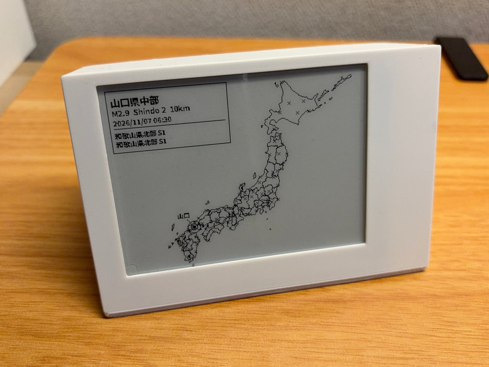
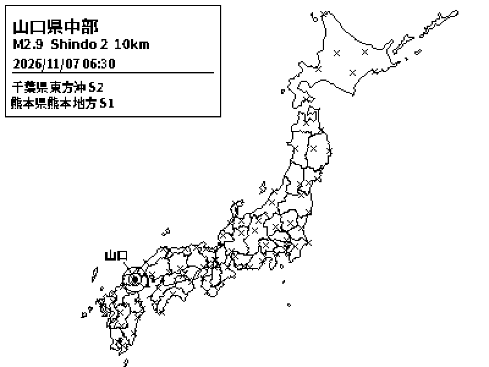
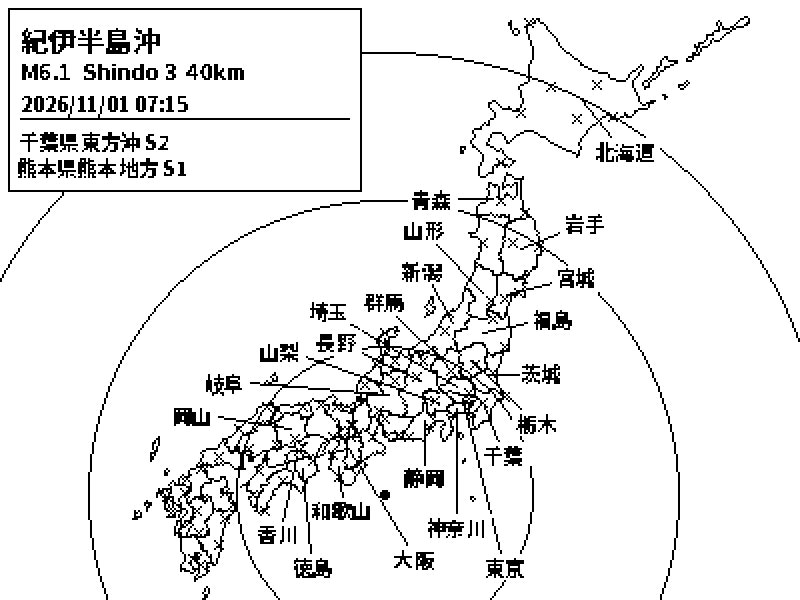
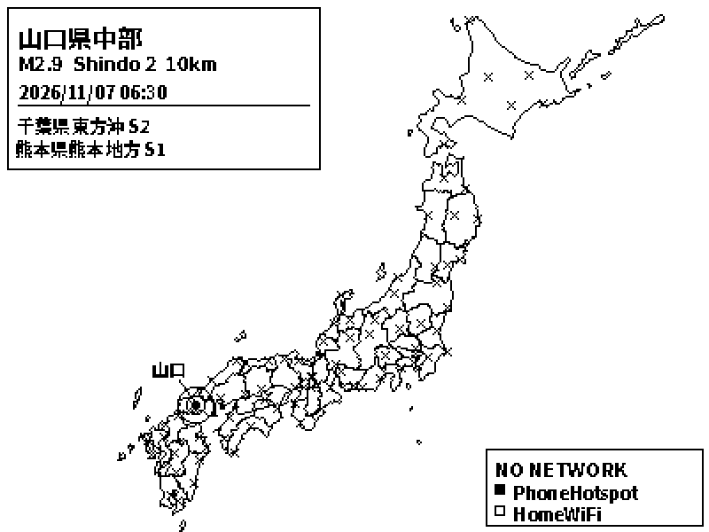

# 日本地震モニター（電子ペーパー版）

[English](README.md) | **日本語**



日本の最新の地震情報を、**ひと目で**確認できる小さな常時表示ディスプレイです。Raspberry Pi Zero と Waveshare の 4.2インチ電子ペーパー（E-Ink）で動き、[P2P地震情報](https://www.p2pquake.net/)が中継する気象庁の地震情報を表示します。

アプリを開く必要も、画面を起こす必要も、テレビも要りません。棚や机に置いて、見るだけです。

## 作った理由

日本の若い世代の多くはテレビを持たなくなっていますが、緊急情報は今もテレビで流れることがほとんどです。そのため、若い人に情報がすぐ届きにくくなっています。そこで、誰でも作れて、机に置いておくだけで、見た瞬間に最新の地震情報が分かる小さな機器を作りました。

表示には省エネのため電子ペーパーを選びました。電子ペーパーは**電力なしで画面を保持**でき、書き換えるときだけ電力を使います。昼間でも見やすく、夜に光ることもなく、スリープもしません。

## 画面の見方



*（これは説明用のサンプルで、実際の地震ではありません。）*

- **左上の枠：** 最新の地震の情報です。震源地、マグニチュード（**M**）、最大震度（**Shindo**）、深さ、時刻を表示します。線の下には、その前の2件（場所と最大震度）が出ます。
- **輪のついた点：** 震央です。輪の数は最大震度を表し（多いほど強い揺れ）、一番外側の輪は揺れが観測された範囲の広さを表します。
- **海岸沿いの県名：** 揺れが報告された都道府県の名前を、その県の近くの海に置き、細い線で県とつないでいます。余裕があるときは、線が交差しないように並べます。
- **小さな × 印：** 地図を見やすくするための固定の目印（約80の町）です。リアルタイムのセンサーではありません。
- **右下の「NO NETWORK」表示：** ネットワークが切れたときだけ出ます。保存済みのWi-Fi名も表示するので、ログインしなくても接続の問題に気づけます。

<p>
  
  
</p>

*左：大きな地震（23都道府県を表示）。右：ネットワーク切断の表示。*

## 必ずお読みください：これは「警報」ではありません

**これは便利な表示装置であり、警報システムではありません。身の安全をこの装置だけに頼らないでください。**

- 表示するのは、気象庁が発表した詳細な**震度情報**（P2P地震情報のコード `551`）で、**発表された後**に表示されます。揺れの前に届く**緊急地震速報には対応していません**（緊急地震速報こそが日本の警報の本体です）。対応の追加は、貢献しやすいテーマです（下の「アイデアと貢献」を参照）。
- 情報は「気象庁 → P2P地震情報 → インターネット → あなたのWi-Fi」と経由します。どこかで遅れたり、誤ったり、途切れたりすることがあります。P2P地震情報も、情報の正確性は保証していないと明記しています。
- 安全のためには、スマートフォンの緊急速報、[気象庁のウェブサイト](https://www.jma.go.jp/)、NHK、お住まいの自治体など、公式の情報源を利用してください。

このプロジェクトの利用によって生じたいかなる損害についても、作者は責任を負いません（[LICENSE](LICENSE) を参照）。

## 特長

- **ポーリングではなくリアルタイム。** WebSocketで常時接続しているため、P2P地震情報が配信してからおよそ1秒以内に描画します。実際のPi Zero WHでは、描画に約0.06秒、パネルの更新に約1.1秒かかります。
- **部分更新。** 新しい地震は、画面全体が白黒に点滅しない高速な部分更新で表示します。残像を消す全画面更新は別に行い（6時間ごと、または部分更新12回ごと）、15分間静かなときだけ実行するので、緊急の更新を遅らせません。
- **何年も放置して動かせる設計。** 自動再接続（バックオフ付き）、固まったら再起動するウォッチドッグ、再起動後も空白にならないキャッシュ、リソースの漏れ対策、不正なデータへの安全な対処を備えています。詳細は [docs/HOW_IT_WORKS.md](docs/HOW_IT_WORKS.md)（英語）にあります。
- **オフラインを画面でお知らせ**（上の表示を参照）。
- **Raspberry Pi Zero で動作。** ブラウザも重いライブラリも不要で、Pillowで直接描画します。
- **ハードウェアなしで試せる。** `python3 render.py --demo` で、どのパソコンでも画面のイメージをPNGに出力できます。

## 必要なもの

| 部品 | 備考 |
|---|---|
| Raspberry Pi Zero WH | Wi-Fiと40ピンヘッダのあるPiなら動くはずです。動作確認はZero WHです。 |
| Waveshare 4.2インチ e-Paper Module **V2**（400×300） | 部分更新に対応した**V2**が必要です。 |
| microSDカード | 何年も動かす機器なので、高耐久タイプがおすすめです。 |
| 5V電源（2.5A推奨）とmicro-USBケーブル | |
| 3Dプリントのケース（任意） | データは [`hardware/`](hardware/) にあります。 |
| Wi-Fi（2.4GHz） | Zeroは5GHzに対応していません。 |

部品の詳細と配線：**[docs/HARDWARE.md](docs/HARDWARE.md)**（英語）。

## ハードウェアなしで試す

どのパソコンでも、Python 3 とパッケージ2つだけで動きます。

```bash
pip install Pillow requests
python3 render.py --demo                        # preview.png を出力
python3 render.py --sample samples/large.json   # 23都道府県の大きな地震
python3 render.py --demo --badge                # 「NO NETWORK」表示つき
python3 render.py                               # 最新の実データ（インターネット接続が必要）
```

## 自分で作る

SDカードの書き込みから、起動時に自動で動く完成形までの手順を、よくある失敗とその直し方も含めて **[SETUP.md](SETUP.md)**（英語）にまとめています。概要は次のとおりです。

1. Raspberry Pi Imager で **Raspberry Pi OS Lite（32-bit）** を書き込みます（ホスト名・ユーザー名・2.4GHzのWi-Fiを設定し、SSHを有効にします）。
2. ディスプレイを接続し、SPIを有効にします（`sudo raspi-config nonint do_spi 0`）。
3. コードを取得し、依存パッケージを入れます。
   ```bash
   git clone https://github.com/juncho26/E-Paper_Japan-Seismic-Monitor.git ~/seismic-epaper
   cd ~/seismic-epaper
   pip3 install -r requirements.txt --break-system-packages
   sudo apt install -y libopenjp2-7 libfreetype6 libtiff6 libjpeg62-turbo libwebp7 liblcms2-2 libxcb1 libharfbuzz0b libfribidi0
   ```
4. Waveshareの `waveshare_epd` ドライバをフォルダにコピーします（SETUP.md のステップ5.3）。
5. `python3 main.py` で動作確認し、起動時に自動で始まるようにサービスを登録します（SETUP.md のステップ7）。

## しくみ

```
 気象庁 ──►  P2P地震情報  ──WebSocket──►  main.py  ──►  render.py  ──►  電子ペーパー
 (公式発表)    (中継)                      (受信・判断)    (400×300の絵を描く)  (表示)
```

`main.py` が接続を保ち、新しい情報が届くたびに画面を更新します。`render.py` が情報を1ビットの画像にします。県名の配置のしかたを含む詳しい説明は **[docs/HOW_IT_WORKS.md](docs/HOW_IT_WORKS.md)**（英語）にあります。

## フォルダ構成

| パス | 内容 |
|---|---|
| `main.py` | Piで動くプログラム本体（接続・更新のタイミング・信頼性）。 |
| `render.py` | 画面を1枚描きます。単体でもプレビュー用に実行できます（`--demo`）。 |
| `netstatus.py` | 「NO NETWORK」表示用にWi-Fiの状態を読みます。ネットワーク名のみで、パスワードは読みません。 |
| `seismic-epaper.service` | 起動時にプログラムを開始し、失敗したら再起動するsystemdの設定。 |
| `requirements.txt` | Pi用のPythonパッケージ。 |
| `data/` | 地図の輪郭、目印の町、県名の配置位置。 |
| `fonts/` | 必要な文字だけに絞った日本語フォント（ライセンス付き）。 |
| `samples/` | インターネットなしで試せる架空のサンプルデータ。 |
| `tools/` | 県名の配置位置を作り直す開発者向けスクリプト。 |
| `hardware/` | 3Dプリントできるケースのデータ。 |
| `docs/` | ガイドと画像。 |
| `SETUP.md` | 作り方の手順書。 |

## カスタマイズ

主な設定は、コメント付きの定数にまとまっています。

- **`render.py`：** `SEA_SIDE` と `HARD_SIDE`（各県名をどちらの海岸に置くか）、`MAX_LABELS`（表示する県名の上限）、`LABEL_FONT`。
- **`main.py`：** `FALLBACK_POLL_SECONDS`、`MAINTENANCE_FULL_REFRESH_SECONDS`、`OFFLINE_AFTER_SECONDS`。

## アイデアと貢献

貢献は大歓迎です。始めやすいテーマは次のとおりです。

- **緊急地震速報（コード `556`）への対応。** WebSocket接続はすでにあります。`main.py` の `on_ws_message` を拡張します。
- **津波情報**（コード `552`）。
- **英語など他言語の表示。**
- 他のサイズのWaveshareパネルへの対応。
- 地震が大きく、県名が混み合うときの配置の改善。

[CONTRIBUTING.md](CONTRIBUTING.md) を参照してください。質問や、作った機器の写真もissueで歓迎します。

## ライセンスとクレジット

コードは [MIT License](LICENSE) で公開しています。3Dケースのデータには別のライセンスがあります（[hardware/README.md](hardware/README.md) を参照）。

このプロジェクトは他者のデータやソフトウェアを利用しています。必要なクレジットとライセンスは [THIRD_PARTY_NOTICES.md](THIRD_PARTY_NOTICES.md) にあります。

- 地震情報：**気象庁**が発表した情報を、**[P2P地震情報](https://www.p2pquake.net/)** が中継したもの。
- 都道府県の輪郭：[dataofjapan/land](https://github.com/dataofjapan/land)。国土地理院の**地球地図日本**がもとになっています。
- **Noto Sans JP** フォント（SIL Open Font License）。必要な文字だけに絞っています。
- 電子ペーパーのドライバ：[Waveshare](https://github.com/waveshareteam/e-Paper)（MIT）。別途インストールします。
