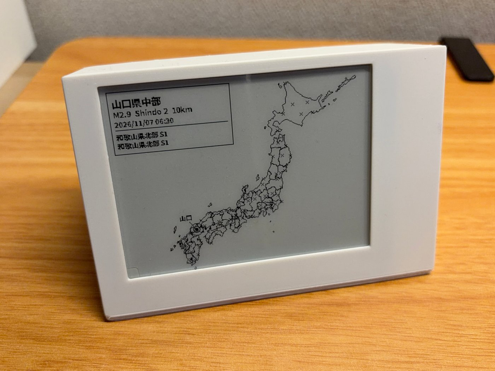
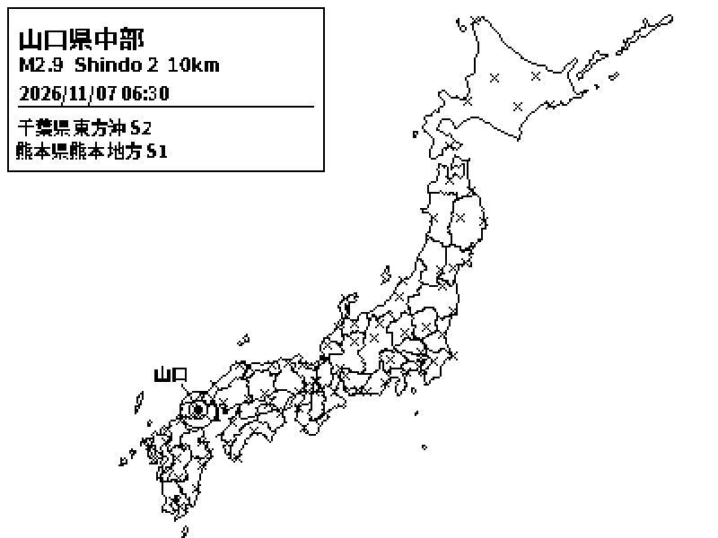
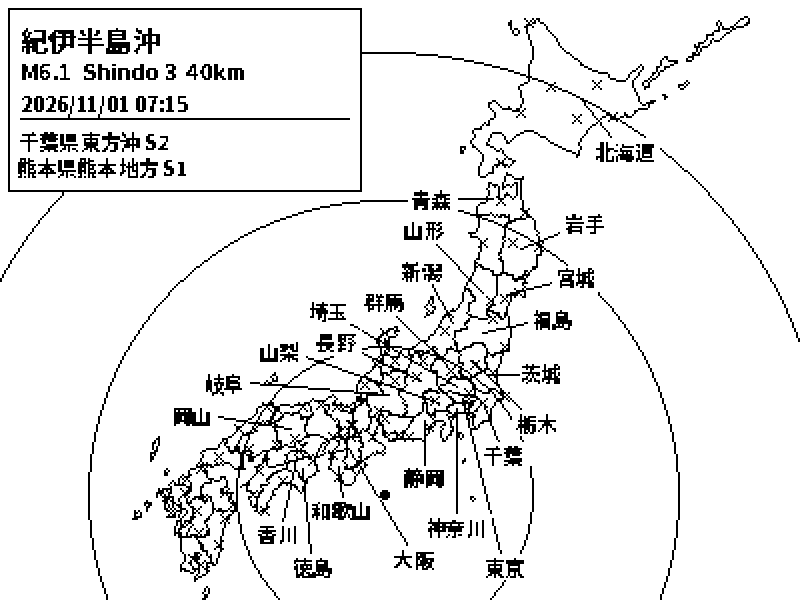
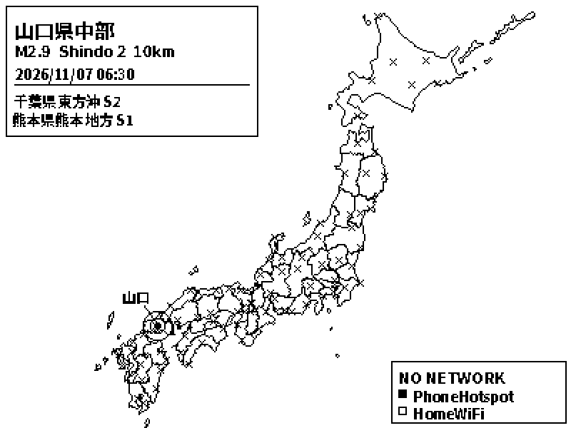

# Japan Seismic Monitor (e-paper)

**English** | [日本語](README.ja.md)



A small, quiet, always-on screen that shows Japan's latest earthquake reports **at a glance**. It is a Raspberry Pi Zero driving a Waveshare 4.2" e-paper (e-ink) display, fed by the Japan Meteorological Agency (JMA) bulletins that [P2PQuake](https://www.p2pquake.net/) relays over the internet.

No app to open, no screen to wake up, no television needed: put it on a shelf and glance at it.

## Why I built this

Many young people in Japan no longer own a television, and emergency information is still mostly broadcast on TV. That makes it harder for them to see it quickly. I wanted something small that anyone can build and leave on a desk, which shows the latest earthquake information the moment you look at it.

I chose e-ink on purpose to save energy: an e-paper panel keeps its picture with **no power at all** and only uses energy while it redraws. It is also readable in daylight, has no glow at night and never goes to sleep.

## What you see on the screen



*(That is an illustrative sample event, not a real one.)*

- **Top-left box:** the latest earthquake: where it happened, its magnitude (**M**), its maximum seismic intensity (**Shindo**, JMA's 0–7 scale), its depth and the time. Below the line are the two reports before it (place and maximum Shindo).
- **The dot with rings:** the epicentre. The number of rings is the maximum Shindo (more rings = stronger shaking), and the outer ring reaches as far as the shaking was reported.
- **Prefecture names around the coast:** every prefecture that reported shaking is named, placed in the sea next to it, with a thin line to the prefecture. The names are laid out so the lines do not cross where there is room.
- **Small × marks:** fixed reference points (about 80 towns) that make the map easier to read. They are not live sensors.
- **Bottom-right "NO NETWORK" badge:** appears only if the Pi has lost its connection. It lists the saved Wi-Fi networks, so you can fix a connection problem without logging in.

<p>
  
  
</p>

*Left: a big event with 23 prefectures named. Right: the "no network" badge.*

## Please read: what this is *not*

**This is a convenience display, not a warning system. Do not rely on it to keep you safe.**

- It shows JMA's detailed **seismic intensity report** (P2PQuake code `551`) *after* JMA publishes it. It does **not** show Earthquake Early Warnings (緊急地震速報), which arrive before the shaking and are the real basis of Japan's alert system. (Adding them is a good first contribution; see [Ideas](#ideas-and-contributions).)
- Reports pass through JMA, then P2PQuake, then the internet, then your Wi-Fi. Any link can be late, wrong or down. P2PQuake states that it does not guarantee the accuracy of its information.
- For safety, use official channels: your phone's emergency alerts, the [JMA website](https://www.jma.go.jp/), NHK and your local government.

The authors accept no liability for any use of this project (see [LICENSE](LICENSE)).

## Features

- **Live, not polled.** A permanent WebSocket connection means a new report is drawn within about a second of P2PQuake publishing it. On a real Pi Zero WH, drawing the picture takes about 0.06 s and the panel update about 1.1 s.
- **Partial refresh.** New events redraw quickly without the full-screen black-and-white flash. A full refresh to clear ghosting happens separately (every 6 hours or after 12 quick refreshes) and only once things have been quiet for 15 minutes, so it never delays an urgent update.
- **Made to run for years unattended.** Automatic reconnection with backoff, a watchdog that restarts the program if it hangs, a cache so the screen is never blank after a reboot, no slow resource leaks, and a safe fallback if the data is malformed. Details in [docs/HOW_IT_WORKS.md](docs/HOW_IT_WORKS.md).
- **Tells you when it is offline** (see the badge above).
- **Runs on a Raspberry Pi Zero.** No browser, no heavy libraries: the picture is drawn directly with Pillow.
- **See it without any hardware.** `python3 render.py --demo` draws the screen to a PNG on any computer.

## What you need

| Part | Notes |
|---|---|
| Raspberry Pi Zero WH | Any Pi with Wi-Fi and a 40-pin header should work; tested on the Zero WH. |
| Waveshare 4.2" e-Paper Module **V2** (400×300) | Must be the **V2**, which supports partial refresh. |
| microSD card | A high-endurance card is worth it for a device that runs for years. |
| 5 V power supply (2.5 A recommended) and a micro-USB cable | |
| 3D-printed case (optional) | Files in [`hardware/`](hardware/). |
| Wi-Fi (2.4 GHz) | The Zero cannot use 5 GHz. |

Full parts list and wiring: **[docs/HARDWARE.md](docs/HARDWARE.md)**.

## Try it without any hardware

You only need Python 3 and two packages, on any computer:

```bash
pip install Pillow requests
python3 render.py --demo                        # writes preview.png
python3 render.py --sample samples/large.json   # a 23-prefecture event
python3 render.py --demo --badge                # with the "no network" badge
python3 render.py                               # the latest real events (needs internet)
```

## Build your own

The full step-by-step guide, from flashing the SD card to a finished, self-starting monitor (with the mistakes everyone makes and how to fix them), is in **[SETUP.md](SETUP.md)**. The short version:

1. Flash **Raspberry Pi OS Lite (32-bit)** with Raspberry Pi Imager (set a hostname, username, 2.4 GHz Wi-Fi and enable SSH).
2. Connect the display and turn on SPI (`sudo raspi-config nonint do_spi 0`).
3. Get the code and install the dependencies:
   ```bash
   git clone https://github.com/juncho26/E-Paper_Japan-Seismic-Monitor.git ~/seismic-epaper
   cd ~/seismic-epaper
   pip3 install -r requirements.txt --break-system-packages
   sudo apt install -y libopenjp2-7 libfreetype6 libtiff6 libjpeg62-turbo libwebp7 liblcms2-2 libxcb1 libharfbuzz0b libfribidi0
   ```
4. Copy Waveshare's `waveshare_epd` driver into the folder (SETUP.md, step 5.3).
5. Test with `python3 main.py`, then install the service so it starts on boot (SETUP.md, step 7).

## How it works

```
 JMA  ──►  P2PQuake  ──WebSocket──►  main.py  ──►  render.py  ──►  e-paper panel
 (official     (relay)               (listens,      (draws the        (shows it)
  bulletin)                           decides)       400×300 picture)
```

`main.py` keeps the connection open and redraws whenever a new report arrives. `render.py` turns the report into a 1-bit picture. The full explanation, including how the prefecture labels are placed, is in **[docs/HOW_IT_WORKS.md](docs/HOW_IT_WORKS.md)**.

## Project layout

| Path | What it is |
|---|---|
| `main.py` | The program that runs on the Pi: connection, refresh timing, reliability. |
| `render.py` | Draws one frame. Also runs on its own for previews (`--demo`). |
| `netstatus.py` | Reads Wi-Fi status for the "no network" badge. Network names only, never passwords. |
| `seismic-epaper.service` | systemd unit that starts the program on boot and restarts it if it fails. |
| `requirements.txt` | Python packages for the Pi. |
| `data/` | Map outlines, reference towns, label positions. |
| `fonts/` | A Japanese font cut down to the characters needed (with its licence). |
| `samples/` | Made-up example events for testing without internet. |
| `tools/` | A developer-only script to rebuild the label positions. |
| `hardware/` | 3D-printable case files. |
| `docs/` | Guides and images. |
| `SETUP.md` | The step-by-step build guide. |

## Customising

Everything lives in a few well-commented constants:

- **`render.py`:** `SEA_SIDE` and `HARD_SIDE` (which coast each prefecture's name goes on), `MAX_LABELS` (cap the number of names), `LABEL_FONT`.
- **`main.py`:** `FALLBACK_POLL_SECONDS`, `MAINTENANCE_FULL_REFRESH_SECONDS`, `OFFLINE_AFTER_SECONDS`.

## Ideas and contributions

Contributions are very welcome. Good places to start:

- **Earthquake Early Warning (code `556`).** The WebSocket connection is already there; `on_ws_message` in `main.py` is where to extend it.
- **Tsunami information** (code `552`).
- **English or other-language labels.**
- Support for other Waveshare panel sizes.
- Better placement of the prefecture names in very crowded events.

See [CONTRIBUTING.md](CONTRIBUTING.md). Questions and photos of your build are welcome in the issues.

## License and credits

The code is released under the [MIT License](LICENSE). The 3D case design has its own licence (see [hardware/README.md](hardware/README.md)).

This project uses data and software from others; the required credits and licences are in [THIRD_PARTY_NOTICES.md](THIRD_PARTY_NOTICES.md):

- Earthquake information from the **Japan Meteorological Agency (気象庁)**, relayed by **[P2PQuake](https://www.p2pquake.net/)**.
- Prefecture outlines from [dataofjapan/land](https://github.com/dataofjapan/land), based on **Global Map Japan (地球地図日本)** by the Geospatial Information Authority of Japan.
- **Noto Sans JP** font (SIL Open Font License), reduced to the characters needed.
- The e-paper driver from [Waveshare](https://github.com/waveshareteam/e-Paper) (MIT), installed separately.
