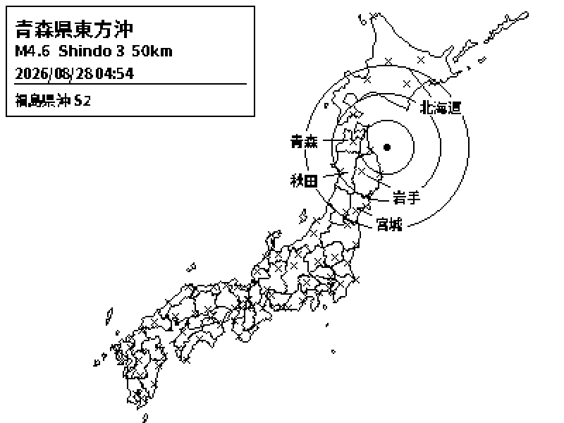
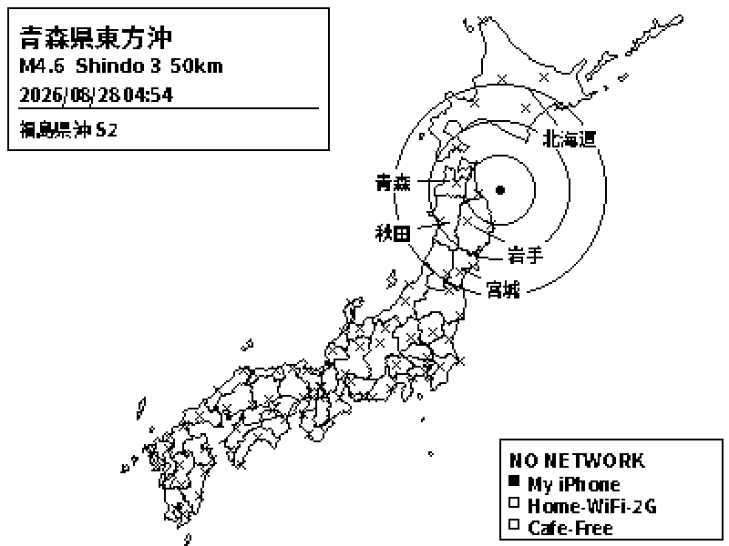

# Japan Seismic Monitor — e-paper edition

An always-on desk display that shows real earthquake activity across Japan, updating within about a second of the Japan Meteorological Agency issuing a report. It runs on a Raspberry Pi Zero WH driving a Waveshare 4.2" e-paper panel, is built to run **unattended for years**, and was designed to prioritize one thing above all: knowing about a real earthquake as fast as the hardware physically allows.



## Overview

This started as a browser-based visualization of Japan's prefectures and monitoring stations, then got rebuilt from the ground up as a native, offline-capable display for e-paper — no browser, no HTML/JS, no GUI, nothing that a Raspberry Pi Zero can't comfortably run for half a decade on a shelf.

It listens to [P2PQuake](https://www.p2pquake.net/), which relays JMA's official earthquake bulletins over a live WebSocket, and renders each new event onto a 400×300 1-bit map: the affected prefecture(s) labeled, the epicenter marked with a set of concentric rings sized to both the shindo (seismic intensity) reading and how far the felt area actually reached, and a compact info box with magnitude, depth, and a short history of recent events.

## Features

- **Live, not polled.** A persistent WebSocket connection to P2PQuake means a new event reaches the display in roughly the time it takes JMA to publish it. The pushed event is drawn immediately, without waiting on any extra HTTP request.
- **Partial-refresh-first.** Every event-triggered update is a fast, flash-free partial refresh. Full refreshes (needed periodically to clear e-paper ghosting) run on their own independent schedule and never compete with an urgent update for priority.
- **Built to run for years without anyone touching it** — systemd watchdog integration to catch real hangs (not just crashes), exponential backoff on every network path, hardware-fault-tolerant SPI calls, and a bounded system journal so logging can't slowly fill the SD card.
- **Tells you when it's offline.** If the Pi has had no working connection for a few minutes, the panel keeps showing the latest event and adds a small "NO NETWORK" badge in the bottom-right corner listing the saved Wi-Fi networks and whether each is in range — so you can see what's wrong from across the room, without SSH. The badge disappears on recovery.
- **Tuned for a Pi Zero's actual limits.** A custom-subset, pre-instanced font (2.5MB instead of the original ~9.5MB variable font), module-level caching for everything that doesn't change between frames, and a static map layer rendered once and reused rather than redrawn on every event.
- **Reads in Japanese, laid out for a tiny monochrome panel.** Prefecture names render in compact Japanese short-form, placed in the sea along the coast next to the prefecture they name, with leader lines that never cross.

## Hardware

- Raspberry Pi Zero WH (or any Pi with a 40-pin GPIO header and Wi-Fi)
- Waveshare 4.2" e-Paper Module **V2**, with partial-refresh support
- A microSD card — ideally a high-endurance one, given the multi-year runtime this is built for

## Repository layout

| Path | What it is |
|---|---|
| `render.py` | Builds one frame. Runs standalone too — `python3 render.py` writes `preview.png` so you can check the layout on any machine, no e-paper hardware required. |
| `main.py` | The long-running process for the Pi: the WebSocket connection, the fallback poll, and all the reliability hardening described below. |
| `netstatus.py` | Reads Wi-Fi state and saved network names via `nmcli` for the offline screen. Names only, never passwords. |
| `data/` | Prefecture boundaries, the monitoring-station list, label anchor points, `label_slots.json` (every sea spot where a label fits, tagged Pacific / Sea of Japan side, for the coastal layout) and `font_charset.txt` (the glyphs the font subset contains, used to sanitize network names). |
| `tools/make_label_slots.py` | Developer-only (needs numpy + scipy; not used on the Pi). Rebuilds `data/label_slots.json` if you change the map bounds, label size or clearances. |
| `fonts/NotoSansJP-Bold.ttf` | A custom-built Japanese font subset — see [Performance on a Pi Zero](#performance-on-a-pi-zero) for why it's not the stock file. |
| `seismic-epaper.service` | The systemd unit that keeps this running persistently, with watchdog, unlimited-retry, CPU priority and memory settings baked in. |
| `state/` | Created at runtime: the last few events, so a reboot starts on the last known picture. Safe to delete. |
| `requirements.txt` | Python dependencies. |
| `SETUP.md` | Step-by-step install guide for the Pi, with troubleshooting. |

## Quick start

The full, tested walkthrough — flashing the card, SSH, drivers, the service, hardening and a Wi-Fi-outage test, plus a troubleshooting table — is in **[SETUP.md](SETUP.md)**. The short version:

1. Flash Raspberry Pi OS Lite with Raspberry Pi Imager (set hostname, username, 2.4 GHz Wi-Fi, enable SSH) and **note your username**.
2. Enable SPI (`sudo raspi-config nonint do_spi 0`), attach the panel, reboot.
3. Clone this repo to `~/seismic-epaper` and install the Python packages:
   ```bash
   pip3 install -r requirements.txt --break-system-packages
   sudo apt install -y libopenjp2-7 libfreetype6 libtiff6 libjpeg62-turbo libwebp7 liblcms2-2 libxcb1 libharfbuzz0b libfribidi0
   ```
   Pillow from pip needs those system libraries on Raspberry Pi OS Lite.
4. Copy Waveshare's `waveshare_epd` driver folder into the project (see SETUP.md, step 5.3).
5. Test: `python3 render.py` (no hardware), then `python3 main.py` (real panel).
6. Install the service with your username filled in:
   ```bash
   sed "s|User=pi|User=$USER|; s|/home/pi|/home/$USER|g" seismic-epaper.service | sudo tee /etc/systemd/system/seismic-epaper.service
   sudo systemctl daemon-reload && sudo systemctl enable --now seismic-epaper
   ```
7. Apply the hardening settings below, reboot, and check the panel.

## Hardening the Pi itself (do once, matters over years)

Three small system settings that make a big difference to a device nobody touches for years. Each is a one-time command; a single reboot at the end applies all of them.

**1. Turn off Wi-Fi power saving.** On the Pi Zero W, Wi-Fi power saving adds latency spikes and occasional dropouts — exactly what you don't want from a live earthquake feed.

```bash
sudo mkdir -p /etc/NetworkManager/conf.d
printf '[connection]\nwifi.powersave = 2\n' | sudo tee /etc/NetworkManager/conf.d/wifi-powersave-off.conf
```

**2. Enable the hardware watchdog.** If the whole system ever hangs (not just this program), the Pi's hardware timer reboots it by itself.

```bash
sudo mkdir -p /etc/systemd/system.conf.d
printf '[Manager]\nRuntimeWatchdogSec=15\nRebootWatchdogSec=2min\n' | sudo tee /etc/systemd/system.conf.d/watchdog.conf
```

**3. (Optional) Keep logs in RAM.** The 50MB journal cap above is already safe. If you would rather the SD card see almost no log writes at all, use this *instead* — the trade-off is that logs disappear on reboot:

```bash
printf '[Journal]\nStorage=volatile\nRuntimeMaxUse=20M\n' | sudo tee /etc/systemd/journald.conf.d/seismic-epaper.conf
```

Then `sudo reboot`, and afterwards check:

```bash
iw dev wlan0 get power_save                               # Power save: off
ls /dev/watchdog                                           # exists
systemctl show -p RuntimeWatchdogUSec                      # 15s, not 0
journalctl -u seismic-epaper | grep health                 # one line every 6 hours
```

## How the display is organized

- **No animation.** E-paper can't show motion, so the P-wave "ripple" is a set of static concentric rings at the epicenter — one ring per shindo point, sized so the outer ring reflects how far the felt area actually reached, not a fixed radius.
- **Only the affected prefecture(s) get labeled**, not all 46 — at 400×300 monochrome, labeling everything permanently would just be noise. Each label sits in the sea right next to the coast, on the free spot nearest its prefecture and on the sea that prefecture faces (Pacific side or Sea of Japan side, see `SEA_SIDE` in `render.py`), with a leader line to it that never crosses another leader — so the labels follow the shape of the country instead of lining up in columns, and neighbouring labels keep their prefectures' relative positions where space allows. Labels have a white backing so the ripple rings never cut through the text, and never touch land, the info box or the offline badge. If a crowded event leaves no room, the older column layout takes over automatically.
- **Stations are plain markers.** Shindo intensity is shown once, at the epicenter — a scaled indicator at every affected station as well added clutter without adding information.

## Offline badge



After 3 minutes without a successful contact with P2PQuake (45 seconds at boot), the normal home screen stays up with the latest event, and a small badge appears in the bottom-right corner: **NO NETWORK** (or **NO INTERNET** if Wi-Fi is joined but nothing is reachable) plus the saved Wi-Fi networks, each marked with a filled square (in range / connected) or a hollow one (not seen). The prefecture labels shrink their ranges to stay clear of it. It repaints only when the network state changes and disappears on the next successful contact. If there has never been an event to show, a full-screen "NO NETWORK" page is used instead.

Only network names are read, never passwords, and anyone who sees the panel can see them. Names the font can't draw (such as curly apostrophes) are shown with plain-ASCII substitutes or `?`. If the list is empty or shows `preconfigured`, run `nmcli -t -f NAME,TYPE connection show` over SSH and check the output.

## Refresh design — tuned for "know about it immediately"

`main.py` holds a live WebSocket connection to P2PQuake, so a new event triggers a partial refresh within roughly a second of JMA issuing it — there's no polling interval to wait through, and the pushed event is rendered directly rather than re-downloaded. A slow fallback poll (60s, one tiny request) runs alongside it purely as a safety net in case the socket dies silently. Each refresh logs its render and panel time (`journalctl -u seismic-epaper | grep partial`) so you can see the real latency on your hardware.

Every event-triggered push is a **partial refresh** — fast, no visible flash. Full refreshes run on their own independent clock (every 6 hours by default, via `MAINTENANCE_FULL_REFRESH_SECONDS`) and only touch the panel during otherwise-quiet time — they never compete with an urgent update for priority.

One real limitation worth knowing: partial refresh alone, run indefinitely, does accumulate some ghosting over time — a property of the panel's waveform, not something software fully avoids. The 6-hour maintenance refresh is a starting point, not a guarantee; shorten it if ghosting builds up faster than that clears it. Since maintenance refreshes are fully decoupled from events, tightening that number never costs any responsiveness during an actual earthquake.

## Performance on a Pi Zero

The Zero WH's single ARM1176JZF-S core and slow SD card make a few things worth doing that wouldn't matter on faster hardware:

- **Font: static and subset, not variable.** A variable font has to interpolate glyph outlines from variation deltas every time it's instanced — real CPU work, repeated on every render if you're not careful. `fonts/NotoSansJP-Bold.ttf` is pre-instanced to a fixed weight and subset to ~6,600 glyphs (JIS X 0208 levels 1+2, covering essentially any real Japanese place name), down from ~9.5MB to ~2.5MB. To rebuild it:
  ```bash
  pip install fonttools
  python -m fontTools.varLib.instancer NotoSansJP-Variable.ttf wght=700 -o static.ttf
  python -m fontTools.subset static.ttf --text-file=charset.txt --output-file=NotoSansJP-Bold.ttf \
      --glyph-names --layout-features='*' --notdef-glyph --notdef-outline --recommended-glyphs
  ```
- **Label placement is cheap, and cached.** The coastal label layout uses exact geometry tests and tries extra handling orders only when the first has crossing lines (a 13-prefecture event takes ~16 ms on a desktop, versus ~100 ms before). The nearest-sea-spot lists for all 47 prefectures are built once at startup (about 4 MB), and the last 8 layouts are cached, so redrawing the same event (the offline badge appearing, recovery) costs about 3 ms. No numpy or scipy is needed on the Pi.
- **Nothing reloads from disk per frame.** Fonts, the three JSON data files, the map projection, and the label-centroid lookup are all built once and cached at module level (`_cache` in `render.py`) rather than rebuilt on every call to `build_frame()`.
- **The static map layer renders once, not every time.** Prefecture outlines and station markers never change between frames — `get_base_map()` renders that layer once and hands back a cheap in-memory `.copy()` per frame instead of re-walking the geojson every time.
- **A pooled, retrying HTTP session**, not a fresh connection per fetch — avoids paying a TLS handshake (real CPU cost here) on every single request.
- **Pillow should install from a prebuilt wheel.** Raspberry Pi OS's `pip` defaults to [piwheels.org](https://www.piwheels.org), which publishes prebuilt armv6 wheels — if `pip3 install Pillow` starts compiling from source instead, something's overridden that default.

## Built for years of unattended operation

- **Exponential backoff, capped low** — the WebSocket reconnect loop and the startup fetch back off from 2s to a 30s cap, resetting the moment a connection succeeds. The cap is deliberately short so the live feed is back within seconds of an outage ending.
- **Never blank after a reboot.** The newest events are saved to `state/last_events.json` (atomic write, only when a new event arrives — a few tiny writes a day). After a power cut the panel immediately shows the last known event, before any network, then updates normally.
- **The watchdog only trips on real hangs.** The poll thread stamps a heartbeat while it waits, so a long outage can never trigger a false restart (every restart would otherwise blank the panel).
- **No slow resource leaks.** Waveshare's `init()` re-opens the SPI bus each time and the underlying `spidev` library never closes the previous handle, so every re-init (the 6-hourly maintenance refresh, fault recovery) leaked a file descriptor — enough to exhaust the 1024-descriptor limit after roughly 8 months, after which nothing can open a socket or the display. Every re-init now releases the bus first (checked by a test that models the leak), and a once-a-minute health check logs open files and memory every 6 hours and exits for a clean systemd restart if either ever crosses a safe limit, instead of degrading silently.
- **Ghosting is cleaned up when it matters.** Besides the 6-hourly full refresh, a full refresh also runs after 12 partial refreshes — at the next quiet moment, never in the middle of an aftershock sequence. Restarts and fault recovery skip the extra clear-screen flash when a full repaint follows anyway.
- **A malformed event can never leave the panel stale.** If the feed ever sends something unexpected (a missing field, a null where a number should be), drawing falls back in steps: full frame, then without per-prefecture detail, then a plain-text "new earthquake report" notice. Something always reaches the panel.
- **A display fault doesn't leave it blank.** If a refresh fails and the driver has to be reset (which clears the panel), the last picture is painted straight back.
- **Maintenance never delays an earthquake.** The 6-hourly full refresh (about 5 seconds) is held back until 15 minutes after the latest event, so aftershock reports are never queued behind it.
- **Cheap polling.** The 60s safety-net poll asks for just the newest event's id and downloads the full history only if it changed.
- **Quiet logs and a calm panel during outages.** Repeated identical warnings are logged once per 30 minutes, and the offline badge repaints at most every 5 minutes and only when what it shows changes, so a flickering Wi-Fi signal can't wear the panel.
- **A systemd watchdog, not just crash detection.** `Type=notify` with `WatchdogSec=200`; `main.py`'s fallback-poll thread pings the watchdog every cycle. A genuine hang (not a crash) still gets caught and restarted.
- **`StartLimitIntervalSec=0`** — systemd's default is to stop restarting a service after too many failures in a short window. Disabled here, since this needs to outlive a bad week of hardware or network issues without anyone around to run `systemctl start`.
- **Every hardware call goes through `safe_hw_call()`** — a flaky SPI transaction logs and retries before being treated as a real failure; a genuine failure re-initializes the display rather than crashing the process.
- **`time.monotonic()` for every interval timer**, not `time.time()` — a Pi Zero has no battery-backed clock, and a post-boot NTP correction shouldn't be able to trigger a spurious (or indefinitely delayed) refresh.
- **A real startup retry loop** — the first fetch keeps retrying instead of giving up after one attempt, and every cache is warmed at startup so the first real event renders at full speed.

### SD card and journal growth

The single biggest long-term failure mode on a Pi Zero isn't the code — it's the microSD card wearing out or filling up. This project writes no log files of its own (everything goes to the systemd journal), but the journal itself needs a cap:

```bash
sudo mkdir -p /etc/systemd/journald.conf.d
printf '[Journal]\nSystemMaxUse=50M\n' | sudo tee /etc/systemd/journald.conf.d/seismic-epaper.conf
sudo systemctl restart systemd-journald
```

Also worth doing: a **high-endurance microSD card**, and a **stable, adequately-rated 5V power supply** — brownouts during an SD write are a common real-world cause of card corruption on long-running Pi deployments, and are outside anything software can fix.

## Going further

`main.py` only acts on code `551` (the detailed seismic-intensity report). P2PQuake's WebSocket feed also carries code `556`, JMA's Earthquake Early Warning — that arrives *before* the detailed report, while the quake may still be shaking, and is the actual basis of Japan's real-time alert system. Extending `on_ws_message` to also render on `556` would be the next place to look for even faster alerting; the WebSocket connection is already there to build on.

## Data sources & credits

- Earthquake data: [P2PQuake](https://www.p2pquake.net/), relaying [JMA](https://www.jma.go.jp/)'s official bulletins.
- Prefecture boundaries: [dataofjapan/land](https://github.com/dataofjapan/land).
- Font: [Noto Sans JP](https://fonts.google.com/noto/specimen/Noto+Sans+JP) (OFL), subset for this project.
- Waveshare e-Paper driver: [waveshareteam/e-Paper](https://github.com/waveshareteam/e-Paper).
