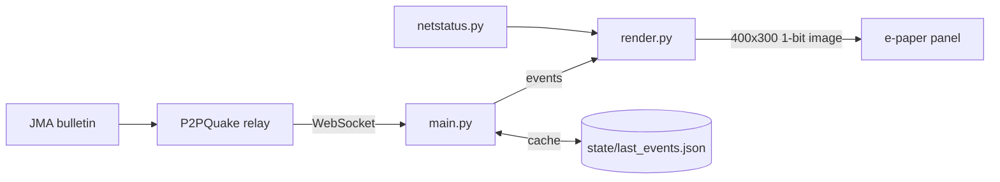

# How it works

## The big picture

1. JMA publishes a seismic intensity report.
2. [P2PQuake](https://www.p2pquake.net/) relays it. This project listens on `wss://api.p2pquake.net/v2/ws` and keeps only code **551** (detailed seismic intensity report).
3. `main.py` receives it, keeps the latest few events, and asks `render.py` for a picture.
4. `render.py` draws the map, the info box and the labels into a 1-bit image with Pillow.
5. `main.py` sends it to the panel with Waveshare's driver, using a quick partial refresh.

On start, and as a safety net every 60 seconds, it also fetches `https://api.p2pquake.net/v2/history?codes=551&limit=N` so a missed message cannot leave the screen stale.

## Modules

| File | Job |
|---|---|
| `main.py` | Connection, timing, caching, health checks, systemd integration. Owns the panel. |
| `render.py` | Turns events into an image. No hardware needed, so it runs on any computer (`--demo`). |
| `netstatus.py` | Reads Wi-Fi state via NetworkManager (`nmcli`) for the offline badge. Names only, never passwords. |
| `seismic-epaper.service` | systemd unit: start on boot, restart on failure, watchdog. |
| `tools/make_label_slots.py` | Offline, developer-only. Pre-computes where labels may sit in the sea. |

## Why the screen updates fast

E-paper has two refresh styles:

- **Full refresh:** flashes black/white, clears ghosting, takes several seconds.
- **Partial refresh:** changes only what differs, about a second, no flash.

New events use partial refresh. A full refresh runs every 6 hours or after 12 partial refreshes, but only once nothing has happened for 15 minutes, so cleanup never delays an urgent update. Measured on a real Pi Zero WH: render 0.06 s, panel 1.14 s.

## What the picture means

- **Epicentre:** a dot at the hypocentre's latitude/longitude.
- **Rings:** `ceil(max_scale / 10)` where P2PQuake's intensity code is 10, 20, 30, 40, 45, 50, 55, 60, 70. Roughly: more rings = stronger shaking. The outer ring reaches the farthest prefecture that reported shaking.
- **Prefecture names:** one per affected prefecture, with a leader line.
- **× marks:** fixed reference towns from `data/stations.json`, not live sensors.

## How labels are placed

Showing up to 46 prefecture names on a 400×300 picture without overlaps is the trickiest part.

1. `tools/make_label_slots.py` (offline) finds every spot in the sea where a 3-character label fits without touching land, and saves them to `data/label_slots.json`. The Pi needs no heavy maths.
2. At runtime, each affected prefecture takes the nearest free slot. Slots on the wrong sea are penalised (`SEA_SIDE`: Pacific vs Sea of Japan), and a few prefectures such as Nagano, Kagawa and Gunma are pinned to one coast (`HARD_SIDE`).
3. Swap passes untangle crossing leader lines, with a retry if a prefecture finds no slot.
4. Above `COASTAL_MAX_LABELS` (26) names, it falls back to a simple column layout, which is faster and always fits.

Known imperfections: in crowded events a few inland prefectures (e.g. Saitama, Yamanashi, Gifu) may land on the "wrong" coast, and with 20+ names a few lines can cross. Improvements are welcome.

## Staying up for years

| Risk | Defence |
|---|---|
| Network drops | Reconnect with backoff (2 s up to 30 s); after 3 minutes without contact an offline badge appears. |
| Process hangs | systemd `WatchdogSec=200`; the program sends a heartbeat (even while sleeping/waiting). |
| Whole system freezes | Hardware watchdog (`RuntimeWatchdogSec=15`, SETUP.md step 8). |
| Reboot or power cut | Last events cached in `state/last_events.json`; repainted on boot. |
| Slow leaks | Health check: more than 200 open files or over 250 MB RSS makes the program exit (code 70) and systemd restarts it. SPI handles are released explicitly. |
| Bad or surprising data | Parsing is defensive; a malformed report is skipped, not fatal. |
| SD card wear | Logs live in RAM; the cache is small and written only when events change. |
| Wi-Fi power saving | Turned off (SETUP.md step 8). |

## Limits

- Only code 551 (after-the-fact intensity reports). **No Earthquake Early Warning**, no tsunami.
- Depends on P2PQuake being up and on JMA's publication delay.
- Japanese place names and prefecture labels only.
- The Zero is 2.4 GHz Wi-Fi only.

## Ideas to extend

- **EEW (code 556):** handle it in `on_ws_message` in `main.py` and add a distinct urgent screen.
- **Tsunami (552)** likewise.
- **Other panels:** the drawing size is set in `render.py`; the driver call lives in `main.py`.
