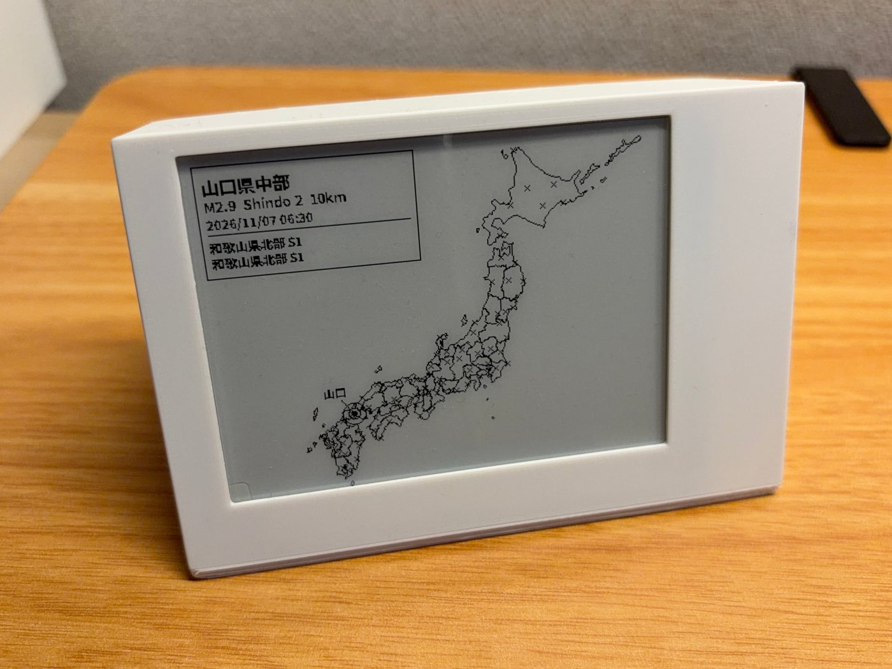

# Case

A 3D-printable case that holds the Raspberry Pi Zero and the 4.2" e-paper display upright on a desk or shelf.

## Files

| File | What it is |
|---|---|
| `E-paper-Cover.step` | The front cover that frames the display. |
| `E-paper-Stand-Left.stl` | Left side of the stand. |
| `E-paper-Stand-Right.step` | Right side of the stand. |

STEP files can be opened in any CAD program (Fusion 360, FreeCAD, Onshape) and edited. If your slicer wants STL, import the STEP into the slicer or export an STL from CAD.

## Printing

Print settings and assembly notes: *to be added by the author.*

## Licence

The case design is released under **Creative Commons Attribution 4.0 (CC BY 4.0)**: you may use, remix and sell prints as long as you credit the original. This is separate from the MIT licence that covers the code.
